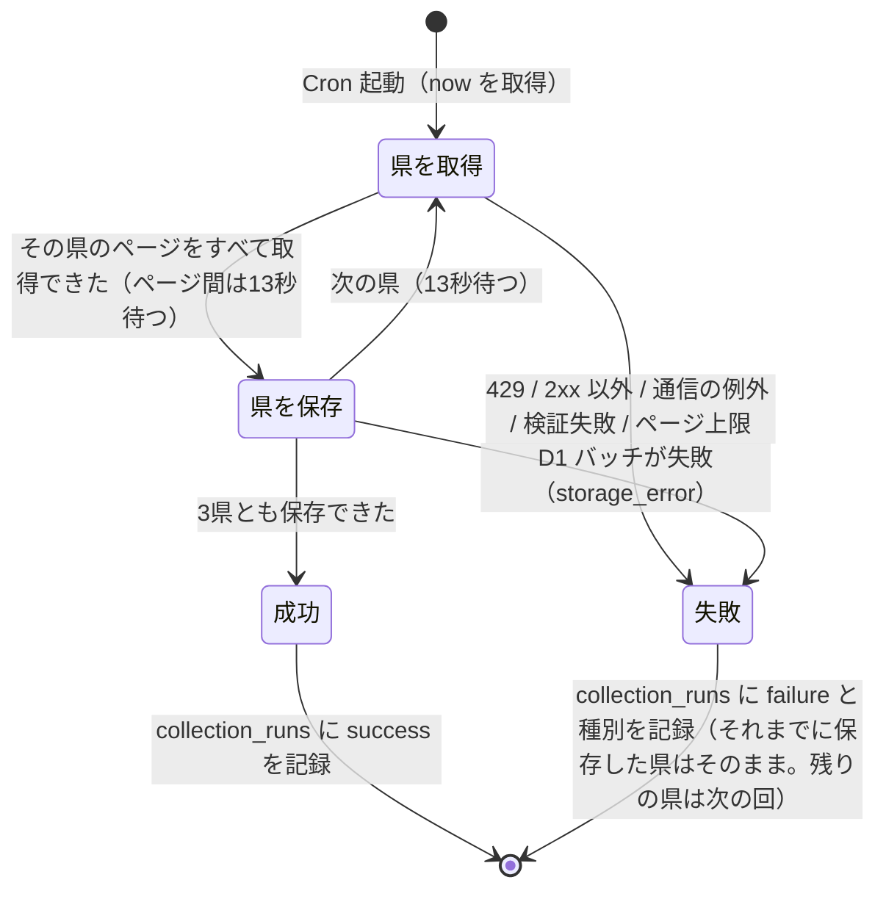
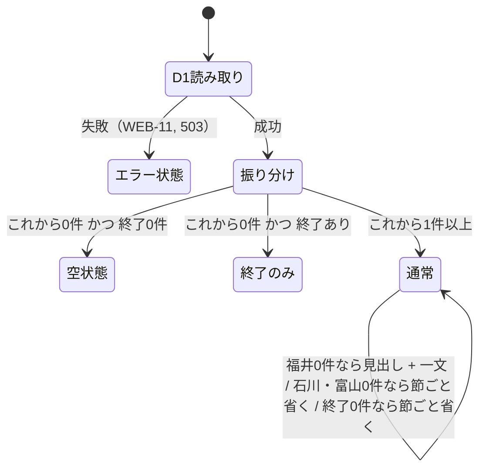
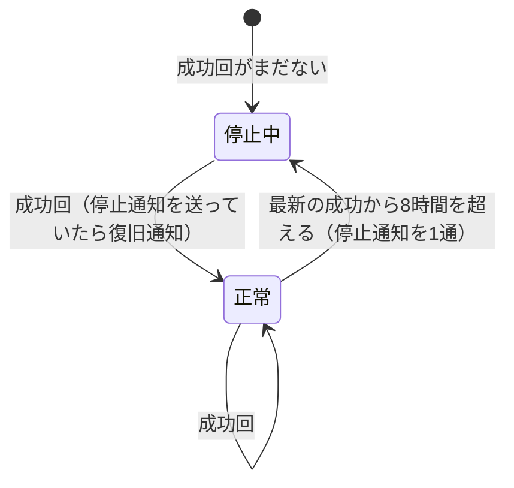

# 03. 振る舞いの要件

各要件には ID・合否の判定条件・検証手段・出典を付ける。検証手段が **test** の要件は、対応する自動テストの `describe` / `it` の名前に ID を含める（例: `describe("WEB-08: 空・端の状態", ...)`）。`npm run spec:check` が、test の要件すべてにテストがあるかを検査する。

時刻の表記はすべて日本時間（JST, UTC+9）。「now」はハンドラの境界で1度だけ取得した現在時刻を指す（05-architecture.md）。

---

## COL: 収集（F-03）

| ID     | 要件                                                                                                                                                                                                                                                                                                                                           | 合否の判定                                                                                                                   | 検証       | 出典                                                                                      |
| ------ | ---------------------------------------------------------------------------------------------------------------------------------------------------------------------------------------------------------------------------------------------------------------------------------------------------------------------------------------------- | ---------------------------------------------------------------------------------------------------------------------------- | ---------- | ----------------------------------------------------------------------------------------- |
| COL-01 | 収集は Cron で3時間ごと（毎時17分、UTC の 0・3・6…時 = JST の 0・3・6…時）に1回起動する。1日8回 × 3県 = 24リクエストで、1日100回（C-04）のうち76回を手元の試験などに残す                                                                                                                                                                       | `wrangler.jsonc` の `triggers.crons` が `["17 */3 * * *"]`                                                                   | config     | C-04（当初の D-38「1時間に1回」から変更）                                                 |
| COL-02 | 1回の収集で fukui → ishikawa → toyama の順に、**県ごとに別のリクエスト**で取得する。各イベントの県は、問い合わせに使った県とする                                                                                                                                                                                                               | フィクスチャで3県を返すと、リクエストの `prefecture` がこの順に1県ずつ並び、保存されたイベントの県が問い合わせの県と一致する | test       | C-10, D-11                                                                                |
| COL-03 | 取得期間は `ym` に「now の前月から5か月後まで」の7か月分を指定する（JST の暦月）                                                                                                                                                                                                                                                               | now = 2026-11-23 のとき `ym=202610,202611,…,202704`                                                                          | test       | D-19（直近14日の終了分を含むため前月から）                                                |
| COL-04 | ページングは `count=100`、`start=1` から始め、返却件数が100未満になるか `start + 返却件数 > results_available` で止める。1県あたり3ページを超えたら `too_many_pages` で失敗する（1日100回の制限があるため、上限を低く保つ）                                                                                                                    | 250件のフィクスチャで3リクエスト、`start` が 1, 101, 201。4ページ目が要る状況で失敗する                                      | test       | C-04                                                                                      |
| COL-05 | 連続するリクエストの開始時刻を **13秒以上**空ける（公式の制限は12秒に1回。余裕を持たせる）。1回の収集の最初のリクエストの前は待たない                                                                                                                                                                                                          | 待機関数を注入し、2回目以降のリクエストの前に毎回 13000ms 待つこと                                                           | test       | C-04                                                                                      |
| COL-06 | リクエストは `https://connpass.com/api/v2/events/` に `X-API-Key: <CONNPASS_API_KEY>` と `User-Agent`（サービス名と公開ページの URL）を付けて送る。User-Agent がないと connpass は 403 を返す。それ以外の URL へは送らない                                                                                                                     | 送られたリクエストの URL の origin と path、ヘッダ                                                                           | test       | C-01, C-03                                                                                |
| COL-07 | 失敗を次の種別に分ける: HTTP 429 → `rate_limited`、その他の 2xx 以外 → `http_error`、通信の例外 → `network_error`、レスポンスの検証失敗 → `invalid_response`、ページ上限 → `too_many_pages`、D1 書き込みの失敗 → `storage_error`。**ある県で失敗したら、その回はそこで止める**（残りの県は次の回に回す）。どの種別でも同じ回の中で再試行しない | 種別ごとのフィクスチャで、記録された `failure_kind` が一致し、失敗の後にリクエストが続かない                                 | test       | C-04                                                                                      |
| COL-08 | **県ごとに保存する。** ある県を取得できたら、その県のイベントと「その県を最後に取得できた時刻」（`prefecture_syncs`）を1つの D1 バッチで反映する。後の県で失敗しても、それより前に取得できた県の保存は取り消さない                                                                                                                             | 2県目で失敗させると、1県目の分は保存され、2県目以降は前回の内容のまま                                                        | test       | C-04（1日100回の制限の下で、取得できた結果を捨てない。2026-11-24 に「全か無か」から変更） |
| COL-09 | 成功・失敗にかかわらず、収集回ごとに `collection_runs` に1行記録する（開始・終了時刻、結果、失敗の種別、取得件数）。**3県すべてを取得・保存できた回だけを成功とする**                                                                                                                                                                          | 成功回・失敗回それぞれで1行増える。1県でも失敗した回は失敗として記録される                                                   | test       | S-05, D-25                                                                                |
| COL-10 | ログに出すのは HTTP ステータス、県、ページ、件数、所要時間、失敗の種別、イベント ID まで。レスポンス本文は出さない                                                                                                                                                                                                                             | `src/log.ts` が許可リスト外の項目を落とす。`console` の直接呼び出しは lint で止まる                                          | lint, test | C-14, C-05                                                                                |
| COL-11 | レスポンスは実行時に検証する。04-data.md の必須フィールドが欠けているか型が違えば、その回を `invalid_response` で失敗させ、何も保存しない。**`undefined` を保存しない**                                                                                                                                                                        | 必須フィールドを1つずつ欠いたフィクスチャで、それぞれ `invalid_response` になる                                              | test       | R-03, project.md Mandated                                                                 |
| COL-12 | 同じ回の中で同じイベントが複数の県で返ったときは、先に処理した県（fukui → ishikawa → toyama）を採る（後の県の保存からは除く）                                                                                                                                                                                                                  | 福井と石川の両方に同じ ID を含めると、福井として保存される                                                                   | test       | C-11                                                                                      |
| COL-13 | `open_status` が `cancelled` のイベントは保存しない（STO-05 により一覧・RSS から消える）                                                                                                                                                                                                                                                       | 中止のフィクスチャが保存されない                                                                                             | test       | 実データとの整合（[S6] の OpenStatus）                                                    |
| COL-14 | connpass への1リクエストは10秒で打ち切り、`network_error` とする                                                                                                                                                                                                                                                                               | 打ち切りの信号が渡され、中断されると `network_error` になる                                                                  | test       | Workers の実行時間の上限                                                                  |

### 収集回の状態

<!-- 文章版: 起動すると県を1つずつ取得し、取得できたらその県を保存する（県ごとの保存）。リクエストの間は13秒空ける。3県とも保存できたら成功。どこかで失敗したらその回はそこで止め、失敗として記録する。それまでに保存した県は取り消さず、残りの県は次の回に回す。 -->

---

## STO: 保存

| ID     | 要件                                                                                                                                                                                                                                                                                | 合否の判定                                                                                                      | 検証 | 出典          |
| ------ | ----------------------------------------------------------------------------------------------------------------------------------------------------------------------------------------------------------------------------------------------------------------------------------- | --------------------------------------------------------------------------------------------------------------- | ---- | ------------- |
| STO-01 | イベントは `(source, source_event_id)` で一意。同じイベントを2回取得しても1行のまま                                                                                                                                                                                                 | 同じフィクスチャで2回収集して行数が変わらない                                                                   | test | B-02          |
| STO-02 | 既存のイベントは、タイトル・URL・日時・場所・住所・定員・参加者数・ハッシュタグ・県・`last_seen_at` を更新する。`first_seen_at` は変えない                                                                                                                                          | タイトルを変えて再収集すると、タイトルは変わり `first_seen_at` は元のまま                                       | test | B-02          |
| STO-03 | `first_seen_at` は、そのイベントを初めて保存した収集回の now                                                                                                                                                                                                                        | 2回目の収集で初登場したイベントの `first_seen_at` が2回目の now                                                 | test | M-02          |
| STO-04 | `last_seen_at` は、そのイベントを取得できた最後の成功回の now                                                                                                                                                                                                                       | 2回連続で取得したイベントの `last_seen_at` が2回目の now                                                        | test | STO-05 の前提 |
| STO-05 | 一覧と RSS に出すのは、**その県を最後に取得できた時点で見えていた**イベント（`last_seen_at` = その県の `prefecture_syncs.synced_at`）だけ。取得できなくなったイベント（中止・削除）の行は残すが、出さない。ある県の取得に失敗した回のあとは、その県は前回取得できたときの内容を出す | 1回目にあって2回目に無いイベントが、2回目の後の一覧に出ない。2回目に石川だけ失敗すると、石川は1回目の内容が出る | test | B-02          |
| STO-06 | 成功回の最後に、`ended_at` が now の30日前より古いイベントと、`finished_at` が now の30日前より古い `collection_runs` を削除する。最新の成功回の行は消さない                                                                                                                        | 31日前に終了したイベントが消え、29日前のものは残る                                                              | test | C-09          |
| STO-07 | 主催者名を保存する列を持たない（恒久的な回帰テスト）                                                                                                                                                                                                                                | `events` の列が許可した列と完全に一致し、`owner` を含む列がない                                                 | test | C-14          |
| STO-08 | `prefecture` は fukui / ishikawa / toyama 以外を保存できない。失敗回は種別を必ず持ち、成功回は持たない                                                                                                                                                                              | D1 の CHECK 制約で拒否される                                                                                    | test | C-10          |

---

## WEB: 公開一覧（F-01）

| ID     | 要件                                                                                                                                                                  | 合否の判定                                                                                                          | 検証         | 出典                      |
| ------ | --------------------------------------------------------------------------------------------------------------------------------------------------------------------- | ------------------------------------------------------------------------------------------------------------------- | ------------ | ------------------------- |
| WEB-01 | 表示対象は STO-05 のイベントのうち、`ended_at > now` のもの（**これから**。開催中を含む）と、`now - 14日 < ended_at ≤ now` のもの（**終了**）。それ以外は出さない     | `ended_at` がちょうど now のものは終了の節に、now − 14日ちょうどのものは出ない                                      | test         | D-19, D-40                |
| WEB-02 | 節は「福井」→「石川・富山」→「終了したイベント」の順。これからの節の中は `started_at` の昇順、終了の節の中は `started_at` の降順。同時刻は `source_event_id` の昇順   | 並びの固定したフィクスチャで、h3 の順序が期待どおり                                                                 | test         | D-20, D-24                |
| WEB-03 | イベントカードは h3 のタイトル（connpass のイベントページへのリンク）、日時、場所、県名バッジ、参加者数、ハッシュタグの順に並ぶ。主催者名と概要文は載せない           | 出力 HTML にこれらが含まれ、主催者名・概要が含まれない                                                              | test         | D-21, D-22, C-14          |
| WEB-04 | 日時は `YYYY-MM-DD (曜) HH:MM - HH:MM`。終了日が開始日と違うときは `YYYY-MM-DD (曜) HH:MM - YYYY-MM-DD (曜) HH:MM`                                                    | 同日・日またぎの両方                                                                                                | test         | wireframes                |
| WEB-05 | 場所は `place` を出す。`place` が空なら `address`、両方空ならその行を空ける（「場所未定」などで補わない）                                                             | 3通りのフィクスチャ                                                                                                 | test         | wireframes                |
| WEB-06 | 参加者数は、定員があれば `参加者数 / 定員 人`、なければ `参加者数 人`                                                                                                 | 2通り                                                                                                               | test         | D-22                      |
| WEB-07 | ハッシュタグはあれば `#タグ` をテキストで出す（リンクしない）。なければ何も出さない                                                                                   | 2通り                                                                                                               | test         | D-22                      |
| WEB-08 | 空・端の状態は次の表のとおり                                                                                                                                          | 表の各行をフィクスチャで再現する                                                                                    | test         | D-26, D-29, D-31          |
| WEB-09 | 終了の節のカードには「終了」の文字を付ける（色だけで区別しない）                                                                                                      | 終了の節の各カードに「終了」が含まれる                                                                              | test         | D-24, D-28                |
| WEB-10 | フッターに「最終収集: YYYY-MM-DD HH:MM」（最新の成功回の `finished_at`、JST）と、提供元 connpass へのリンクを出す。成功回が一度もなければ「最終収集: まだありません」 | 2通り                                                                                                               | test         | D-25                      |
| WEB-11 | D1 の読み取りに失敗したら、「現在イベントを表示できません」の一文だけを出し、HTTP 503 を返す。最終収集日時も出さない。**「0件」と同じ見え方にしない**                 | D1 を失敗させると 503 で、空状態の文言を含まない                                                                    | test         | D-30, project.md Mandated |
| WEB-12 | `<head>` に RSS の自動検出リンク（`<link rel="alternate" type="application/rss+xml" href="/feed.xml">`）を置き、フッターに「RSS」へのリンクを置く                     | 出力 HTML に両方が含まれる                                                                                          | test         | C-13 の変更（2026-11-23） |
| WEB-13 | 見出し構造は h1（サイト名、1つ）→ h2（節）→ h3（イベント）。`header` / `main` / `footer` を使い、`lang="ja"` を宣言する                                               | 出力 HTML の構造                                                                                                    | test         | D-28                      |
| WEB-14 | 件数による打ち切り・ページ分割はしない                                                                                                                                | —                                                                                                                   | 実測         | 北陸3県 × 期間限定のため  |
| WEB-15 | セキュリティヘッダ（CSP、`X-Content-Type-Options`、`Referrer-Policy`）を付ける。インラインスクリプト・インラインスタイルを使わない                                    | `web/public/_headers`（静的ファイル）と、Functions の応答に付けたヘッダ（`_headers` は Functions の応答に効かない） | test, config | team.md「Deployment」     |
| WEB-16 | 第三者由来の文字列はすべてエスケープして出力する                                                                                                                      | `<script>` を含むタイトルがエスケープされて出る。素の文字列連結での HTML 組み立ては lint で止まる                   | test, lint   | C-12                      |
| WEB-17 | 出力に主催者名が現れない（恒久的な回帰テスト）。主催者名を含むフィクスチャを収集から描画まで通しても出ない                                                            | 出力 HTML に、フィクスチャに入れた主催者名の文字列が含まれない                                                      | test         | C-14                      |

### WEB-08: 空・端の状態

| 状況                               | 表示                                                                                                         |
| ---------------------------------- | ------------------------------------------------------------------------------------------------------------ |
| これから・終了ともに0件            | **空状態**: 本文は「該当する期間に開催されるイベントはありません。」の一文だけ。フッターの最終収集日時は出す |
| 福井が0件、石川・富山はある        | 「福井」の見出しは出し、その下に「現在、福井で開催予定のイベントはありません。」を置く。見出しごと消さない   |
| 石川・富山が0件、福井はある        | 「石川・富山」の見出しごと出さない                                                                           |
| 終了が0件                          | 「終了したイベント」の見出しごと出さない                                                                     |
| これからが3県とも0件、終了だけある | 「福井」「石川・富山」の見出しは出さず、終了の節だけを出す。空状態にしない                                   |
| タイトルが非常に長い               | 折り返す。省略記号で切らない                                                                                 |

福井と石川・富山で扱いを変えるのは意図的。福井は主対象なので、見出しが消えると「集めていない」のか「たまたま0件」なのかが区別できない。

### 公開一覧の表示状態

<!-- 文章版: まず D1 を読む。失敗したらエラー状態（503、最終収集日時なし）。成功したら、これからと終了の件数で振り分ける。両方0件なら空状態、これからが0件で終了があれば終了の節だけ、これからが1件以上なら通常。通常の中で、福井が0件なら見出しと一文を残し、石川・富山や終了が0件なら節ごと省く。 -->

---

## RSS: RSS（F-02）

公開ページと同じ Pages で配信する。認証はしない（C-13 の変更）。

| ID     | 要件                                                                                                                                                                                                                                               | 合否の判定                                      | 検証         | 出典                |
| ------ | -------------------------------------------------------------------------------------------------------------------------------------------------------------------------------------------------------------------------------------------------- | ----------------------------------------------- | ------------ | ------------------- |
| RSS-01 | `GET /feed.xml`（Pages）で配信する                                                                                                                                                                                                                 | 200 が返る                                      | test         | C-13 の変更         |
| RSS-02 | **Worker は HTTP で何も公開しない**。`wrangler.jsonc` で `workers_dev: false`・`preview_urls: false` とし、`fetch` はどのパスにも 404 を返す（恒久的な回帰テスト）                                                                                 | 任意のパスで 404                                | test, config | C-06                |
| RSS-03 | RSS 2.0。`Content-Type: application/rss+xml; charset=utf-8`、`Cache-Control: public, max-age=300`                                                                                                                                                  | レスポンスヘッダと、XML として妥当であること    | test         | W-02                |
| RSS-04 | 項目は STO-05 のイベントのうち `ended_at > now` のもの（3県すべて）を、`first_seen_at` の降順で最大100件                                                                                                                                           | 101件のフィクスチャで100件、並び順              | test         | D-39                |
| RSS-05 | イベント項目は `title` = `[福井] タイトル`（県名を角括弧で前置）、`link` = connpass の URL、`guid` = `connpass:{source_event_id}`（`isPermaLink="false"`）、`pubDate` = `first_seen_at`（RFC 822）、`description` = 日時・場所・参加者数のテキスト | 1件のフィクスチャで各要素                       | test         | W-02                |
| RSS-06 | 同じイベントの `guid` は、タイトルや日時が更新されても変わらない（RSS リーダーで二重に通知されない）                                                                                                                                               | 更新前後で guid が同じ                          | test         | M-02                |
| RSS-07 | `&`、`<`、`]]>`、XML で使えない制御文字を含むタイトルでも、妥当な XML になる                                                                                                                                                                       | `src/markup/markup.test.ts` と RSS の結合テスト | test         | C-12                |
| RSS-08 | `channel` の `title` は「北陸ITイベント」、`link` はリクエストの origin（公開ページ）、`lastBuildDate` は now                                                                                                                                      | 各要素                                          | test         | W-02                |
| RSS-09 | D1 の読み取りに失敗したら 503 を返す。空のフィードを返さない（RSS リーダーが「0件になった」と解釈しないように）                                                                                                                                    | D1 を失敗させると 503                           | test         | WEB-11 と同じ考え方 |

---

## HLT: 収集の健全性（F-04）

停止に気づく手段は **Discord Webhook への通知**。判定と送信は Cron の各収集回の最後に行う。

| ID     | 要件                                                                                                                                                                                 | 合否の判定                                                                                                             | 検証 | 出典                                                                                                                         |
| ------ | ------------------------------------------------------------------------------------------------------------------------------------------------------------------------------------ | ---------------------------------------------------------------------------------------------------------------------- | ---- | ---------------------------------------------------------------------------------------------------------------------------- |
| HLT-01 | **停止中**の判定: 最新の成功回（3県すべて取得できた回）の `finished_at` が now − 8時間より前、または成功回が一度もない                                                               | ちょうど8時間前は停止中でない。8時間1ミリ秒前は停止中。成功回なしは停止中                                              | test | S-05（3時間ごとの収集が3回続けて失敗した時点で判定される。成功回の終了は起動より数十秒遅いので、9時間ではなく8時間で区切る） |
| HLT-02 | 停止中に入ったら、Discord に**停止通知**を1通送る。本文は最終成功日時（なければ「まだありません」）と直近の失敗回の種別。**1回の停止につき1通だけ**（同じ停止の間は2通目を送らない） | 失敗回が続く間、通知は1通。送信済みの記録（`notifications`）のキーは `stale:{最新の成功回の finished_at または never}` | test | S-05, D-42                                                                                                                   |
| HLT-03 | 停止通知を送った後に成功回が記録されたら、**復旧通知**を1通送る                                                                                                                      | 停止 → 成功で1通。停止通知を送っていなければ復旧通知も送らない                                                         | test | S-05                                                                                                                         |
| HLT-04 | 送信に失敗したら（2xx 以外・通信の例外）、エラーログを出し、送信済みとして記録しない（次の収集回で再送される）。送信の失敗は収集回の結果を変えない                                   | Webhook が 500 を返すと記録されず、次の回で再送される                                                                  | test | construction.md「silent failures」                                                                                           |
| HLT-05 | 送り先は `DISCORD_WEBHOOK_URL`（Worker のシークレット）。`https://discord.com/api/webhooks/` で始まらなければ送らずにエラーログを出す。未設定なら送らない（ローカル開発のため）      | 3通り                                                                                                                  | test | C-03                                                                                                                         |
| HLT-06 | 通知の本文に、イベントの情報（タイトル・主催者名など）を含めない。日時と失敗の種別だけ                                                                                               | 本文の文字列                                                                                                           | test | C-14, C-05                                                                                                                   |
| HLT-07 | 失敗回はエラーレベルのログを1行出す（種別、所要時間）                                                                                                                                | `logError` が呼ばれる                                                                                                  | test | S-05                                                                                                                         |
| HLT-08 | 公開ページには警告を出さない。フッターの最終収集日時だけで示す                                                                                                                       | 停止中でも公開ページに警告の文言がない                                                                                 | test | D-25                                                                                                                         |
| HLT-09 | **Cron 自体が動かない場合は検知できない**（通知は収集回の中で送るため）。その場合は公開ページのフッターの日付が古いまま残ることで気づく                                              | —                                                                                                                      | 実測 | 既知の限界                                                                                                                   |

### 健全性の状態

<!-- 文章版: 最初は成功回がないので停止中。成功回が記録されると正常になる。このとき停止通知を送っていたなら復旧通知を送る。成功が続く限り正常のまま。最新の成功から8時間を超えると停止中に戻り、停止通知を1通送る。 -->

---

## M: 成功指標の測り方

| ID   | 測り方                                                                                                                                 | 検証 | 出典 |
| ---- | -------------------------------------------------------------------------------------------------------------------------------------- | ---- | ---- |
| M-02 | 期間内に終了したイベントのうち、`first_seen_at < started_at` を満たすものの割合。目標 100%。D1 に対する SQL で測る（06-operations.md） | 実測 | D-41 |

「配信対象を選ぶロジックが正しいか」は RSS-04 のテストで、「実際に配信され続けたか」はこの実測で確かめる。
